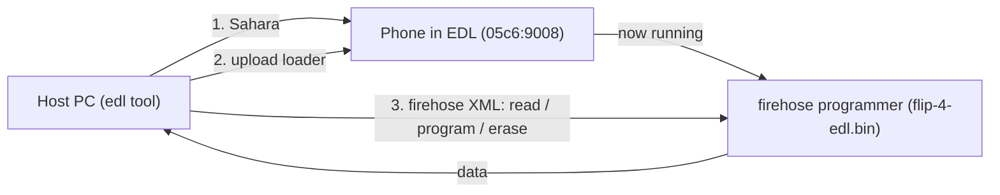

# tcl-flip-4-android

**Research and tooling for bringing full Android 14 to the TCL Flip 4 5G (T440W)** -
replacing the KaiOS 4 userspace inside `super` while retaining the stock Android 14
GKI kernel and Qualcomm vendor BSP, re-signed with the public AOSP test keys the
device's locked bootloader already trusts.

> **Looking only to root stock KaiOS 4 (`adb root` + permissive SELinux)?**
> See the upstream repository: **[tcl-flip-4-root](https://github.com/ambercaravalho/tcl-flip-4-root)**.

> ## Read this first - this is experimental and dangerous
>
> - This is **unofficial, experimental** reverse-engineering and OS bringup
>   research conducted on **one specific phone**. Nothing here is guaranteed to
>   be safe on yours.
> - Writing to flash over EDL **can and may well PERMANENTLY BRICK your phone.**
>   There is no warranty and no undo button.
> - **Do your own research.** Understand each step before you run it. If a command
>   doesn't make sense to you, stop.
> - **ALWAYS MAKE A FULL, VERIFIED BACKUP BEFORE DOING ANYTHING** with
>   `scripts/backup.sh`. Every image we inspect or patch is carved from that
>   backup and is reversible - as long as the backup exists.
>
> You accept all risk. See [LICENSE](LICENSE): provided "as is", without warranty.

---

## Project Goal & Technical Foundation

Although the **TCL Flip 4 5G (model T440W, `gflip5gtmo` / `pitti_32go`)** ships
with KaiOS 4, its underlying platform is a standard **Android 14 (SDK 34, Linux
`6.1.90-android14`)** Treble/GKI architecture:

1. **Android 14 GKI & Treble separation:**
   - The boot chain (`boot`, `init_boot`, `vendor_boot`, `dtbo`) and hardware
     support partitions (`vendor`, `odm`, `vendor_dlkm`, `system_dlkm`) are
     standard Android 14 GKI / Qualcomm BSP images.
   - The KaiOS 4 environment lives in the userspace dynamic partitions inside
     `super` (`system`, `system_ext`, `product`).
2. **AVB uses public AOSP test keys across the verification tree:**
   - Top-level **`vbmeta`** (plus `boot` and `recovery` footers, and the
     hashtree descriptors for `vendor`, `odm`, `vendor_dlkm`, `system_dlkm`) is
     signed with `SHA256_RSA4096` matching the public **AOSP `testkey_rsa4096`**
     (`tools/avb/testkeys/testkey_rsa4096.pem`).
   - Chained **`vbmeta_system`** (covering the hashtree descriptors for
     `system`, `system_ext`, and `product`) is signed with `SHA256_RSA2048`
     matching the public **AOSP `testkey_rsa2048`**
     (`tools/avb/testkeys/testkey_rsa2048.pem`, identified by
     [@ryjelsum](https://github.com/ryjelsum) in
     [tcl-flip-4-root#3](https://github.com/ambercaravalho/tcl-flip-4-root/issues/3)).
3. **Locked-bootloader userspace / GSI bringup:**
   Because the private halves of the device's AVB signing keys are public (and
   bundled in `tools/avb/testkeys/`), we can replace or rebuild the userspace
   partitions (`system`, `system_ext`, `product`) inside `super`, re-sign
   `vbmeta_system` (and `vbmeta` when adjusting `odm`/`vendor`), and flash over
   Qualcomm EDL - **without unlocking the bootloader or disabling Android
   Verified Boot**.

For the full partition architecture, AVB verification tree diagram, VABC notes,
and offline inspection/signing commands, see
**[docs/PARTITIONS_AND_AVB.md](docs/PARTITIONS_AND_AVB.md)**.

---

## The Device

| Property | Value |
|---|---|
| Phone | TCL Flip 4 5G / "Go Flip 5G", model **T440W** (`gflip5gtmo` / `pitti_32go`) |
| Stock OS | **KaiOS 4 on Android 14** base, `user`/test-keys, SDK 34, kernel `6.1.90-android14` |
| SoC | Qualcomm (HWID `0x002980e100420071`, MSM_ID `0x002980e1`) |
| EDL USB ID | `05c6:9008` |
| Storage | eMMC, 512-byte sectors, ~29.12 GiB (61,079,552 sectors) |
| Layout | GPT, **A/B slots** (`_a`/`_b`), **Virtual A/B (VABC)**, `super`, `userdata`; active slot **B** |
| AVB Keys | Public **AOSP `testkey_rsa4096`** (`vbmeta`) + **`testkey_rsa2048`** (`vbmeta_system`) |
| EDL Loader | `loader/flip-4-edl.bin` (signed firehose programmer, required) |

---

## Repository Layout & Tooling

- **`vendor/edlclient/`** & **`scripts/edl`** - Vendored, patched
  [bkerler/edl](https://github.com/bkerler/edl) v3.62 that works reliably with
  the Flip 4's firehose programmer (see [docs/PATCHES.md](docs/PATCHES.md)).
- **`loader/flip-4-edl.bin`** - Signed Qualcomm/TCL firehose programmer for the
  T440W.
- **`tools/avb/`** - Vendored AOSP `avbtool.py` and the public AOSP test keys
  (`testkey_rsa4096.pem`, `testkey_rsa2048.pem`, `testkey_rsa8192.pem`).
- **`tools/setpermissive.c`** - `libsepol` utility to mark all SELinux types in
  a binary `precompiled_sepolicy` permissive for bringup debugging.
- **`scripts/extract-partition.py`** - Carve any GPT partition out of a full raw
  eMMC dump offline (`--list` to inspect the GPT).
- **`scripts/inspect_ext4.py`** - Fast, pure-Python seek-based `ext4` inspector
  (`ls`, `find`, `cat`, `dump`) that extracts files without root mount or
  `debugfs`.
- **`scripts/lp_extract.py`** & **`scripts/lp_make.py`** - Inspect `super`
  `liblp` metadata, extract logical partitions, and build surgical or full
  `super` metadata/images offline.
- **`scripts/prepare_gsi.py`** - End-to-end offline GSI preparation pipeline:
  unsparses an Android 14 `a64_bvN` GSI, verifies 32-bit ARM `/system/bin/init`,
  patches keypad mappings (`Generic.kl` + `/odm/usr/keylayout/`), compiles a
  merged permissive `precompiled_sepolicy` (`GSI + vendor + t440w_compat.cil`),
  re-signs `vbmeta_b` and `vbmeta_system_b`, and builds surgical `super`
  metadata.
- **`scripts/patch_vbmeta.py`** - Surgically update a hashtree descriptor (`root_digest`,
  `image_size`, `tree_offset`, `tree_size`, `salt`, `fec_*`) in `vbmeta` or
  `vbmeta_system` and re-sign with OpenSSL.
- **`device/t440w/`** - Extracted stock hardware reference files (`build.prop`,
  `fstab.emmc`, VINTF manifests/matrices, kernel `ikconfig`, SELinux
  compatibility CIL, and stock + Android-adapted `.kl` keypad layouts).
- **`scripts/backup.sh`** / **`scripts/flash-partition.sh`** /
  **`scripts/check-device.sh`** - Device detection, verified full-eMMC backup,
  and guarded partition flashing with read-back verification.

---

## Getting Started (Setup & Full Backup)

### 1. Install the host environment

Requires Python 3 and a data-capable USB cable. On macOS there are **no drivers
to install** - `libusb` (via `pyusb`) talks to the device directly.

```bash
scripts/setup.sh
```

This creates `.venv/`, installs `requirements.txt`, and verifies the vendored
`edl` loads.

**Linux only:** install the udev rules, then replug the phone:

```bash
sudo cp linux/51-edl.rules linux/50-android.rules /etc/udev/rules.d/
sudo udevadm control --reload-rules && sudo udevadm trigger
```

### 2. Enter EDL mode (`05c6:9008`)

Qualcomm SoCs expose a low-level Emergency Download mode (**EDL**, USB
`05c6:9008`). In EDL the chip speaks **Sahara** to accept the signed firehose
programmer (`loader/flip-4-edl.bin`), then speaks **firehose** (XML-over-USB)
to read or write flash.



Ways to enter EDL mode (easiest first):
1. **ADB** (if USB debugging is on): `adb reboot edl`
2. **Fastboot** (if reachable): `fastboot oem edl`
3. **Key combo:** power off fully, hold both volume keys while plugging in USB.
4. **Test point:** short the labeled EDL test point to ground while connecting
   USB (last resort).

Confirm the phone is visible to `libusb`:

```bash
scripts/check-device.sh
```

### 3. Make a full, verified eMMC backup (mandatory before any work)

```bash
scripts/backup.sh
```

This dumps the entire ~29.12 GiB eMMC to `backups/flip4-full-emmc.img` (~15 min
at ~35 MB/s) and verifies that both the primary and backup GPT headers are
intact and 512-byte aligned. Copy `backups/flip4-full-emmc.img` to safe external
storage before doing anything else. To exit EDL mode afterward, **pull the
battery for ~10s and power on**.

---

## The One Operational Rule: Reads vs Writes

This device's firehose loader requires different flags for reads vs writes. The
helper scripts handle this automatically, but if you invoke `scripts/edl`
directly:

- **READ / dump** (`r`, `rs`, `rf`, `rl`, `printgpt`): pass **`--skipresponse`**.
- **WRITE / erase** (`w`, `ws`, `wf`, `wl`, `e`): do **NOT** pass
  `--skipresponse`, or the write reports success but silently does not commit.

Always read back any written partition/sectors with `--skipresponse` and compare
SHA-256 hashes before rebooting. Full explanation:
[docs/PATCHES.md](docs/PATCHES.md).

---

## Troubleshooting

- **Hangs at "Trying to read first storage sector..."** - a read command is
  missing `--skipresponse`.
- **A write "succeeded" but didn't stick** - you passed `--skipresponse` on a
  write; re-run without it and read back to verify.
- **`check-device.sh` says NOT FOUND** - phone is not in EDL, cable is
  charge-only, or connected through a hub. Re-enter EDL and use a direct port.
- **Everything hangs after killing a command** - killing `edl` mid-transfer
  leaves the loader in a stale Sahara/firehose state. Pull the battery for ~10s
  and re-enter EDL.
- **`reset` doesn't reboot** - known limitation of this loader; pull the battery
  and power on.

---

## Documentation Map

- **[docs/BRINGUP_NOTES.md](docs/BRINGUP_NOTES.md)** - Phase 1 hardware/software
  findings (`a64` / `arm32_binder64` ABI, SELinux `b2g_34_0` bridge, physical
  flip keypad `.kl` mappings, surgical `super` layout) and the Phase 2 EDL flash
  and rollback runbook.
- **[docs/PARTITIONS_AND_AVB.md](docs/PARTITIONS_AND_AVB.md)** - Partition
  architecture (`super`, GKI A/B, VABC), the AOSP test-key AVB chain (`vbmeta` +
  `vbmeta_system`), offline carving/signing commands, and the Android
  userspace/GSI bringup strategy.
- **[docs/CAPABILITIES.md](docs/CAPABILITIES.md)** - Reference for every
  firehose command the loader exposes (backup, restore, erase, slots, raw sector
  I/O, memory).
- **[docs/PATCHES.md](docs/PATCHES.md)** - What was fixed in the vendored `edl`,
  and why `--skipresponse` must be used on reads and omitted on writes.

---

## Credits and License

- Prior KaiOS 4 root research & tooling base:
  **[tcl-flip-4-root](https://github.com/ambercaravalho/tcl-flip-4-root)**.
- Inspired by and built on Ryjelsum's writeup,
  [*Continuing my Qualcomm garbage addiction: QM215 KaiOS flip phones*](https://ryjelsum.me/homelab/qm215-kaios-flips/),
  and their discovery that `vbmeta_system` uses `testkey_rsa2048`
  ([tcl-flip-4-root#3](https://github.com/ambercaravalho/tcl-flip-4-root/issues/3)).
- EDL tool: [bkerler/edl](https://github.com/bkerler/edl) (c) B. Kerler, GPLv3 -
  vendored, patched, and slimmed in `vendor/edlclient/` (see its `LICENSE`).
- `loader/flip-4-edl.bin`: proprietary Qualcomm/TCL signed firehose programmer,
  redistributed for interoperability/backup.
- See [NOTICE](NOTICE) for full attributions. Because the vendored `edl` is
  GPLv3, redistributing that directory must comply with the GPLv3.
