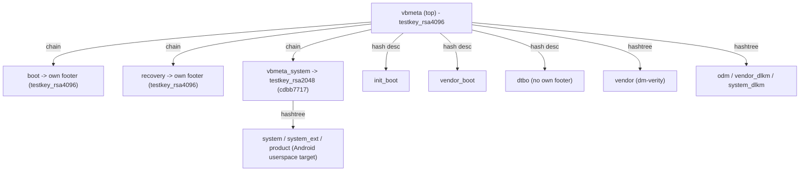

# TCL Flip 4 5G - Partition Architecture, AVB Test Keys, and Android Bringup

> **Experimental / brick risk.** This is unofficial reverse-engineering and
> bringup research for the **TCL Flip 4 5G (T440W)**. Writing to flash over EDL
> can **permanently brick** your phone. Always make a full, verified backup
> first (`scripts/backup.sh`) and keep per-partition pre-flash backups so every
> write is reversible. See the [README](../README.md).
>
> Looking only to root the stock KaiOS 4 OS (`adb root` + permissive SELinux)?
> See the upstream **[tcl-flip-4-root](https://github.com/ambercaravalho/tcl-flip-4-root)**
> repository.

---

## 1. Architecture Overview: KaiOS 4 on an Android 14 GKI/Treble Base

Although the TCL Flip 4 5G (`T440W`, `gflip5gtmo` / `pitti_32go`) ships with
KaiOS 4, underneath it is a standard **Android 14 (SDK 34, Linux `6.1.90-android14`)**
Treble/GKI device:

- **GKI A/B boot chain:**
  - `boot`: generic kernel image only (no ramdisk).
  - `init_boot`: generic first-stage `init` ramdisk.
  - `vendor_boot`: vendor kernel modules, `fstab`, and `bootconfig`.
  - `dtbo`: device tree overlay partition.
- **`super` dynamic partitions (`liblp`):**
  - **Userspace (system) side:** `system`, `system_ext`, `product` (currently
    hosting the KaiOS 4 runtime / B2G stack on top of an Android 14 base).
  - **Hardware / BSP (vendor) side:** `vendor`, `odm`, `vendor_dlkm`,
    `system_dlkm` (Qualcomm HALs, kernel modules, device configs, SELinux
    precompiled policy).
- **Slot layout:** A/B (`_a` / `_b`) with **Virtual A/B (VABC)** snapshots +
  compression. On the reference unit, active slot is **B** (`liblp` slot `1`).

Because the kernel and vendor/BSP partitions already implement an Android 14
Treble boundary, bringing full Android 14 to the device does **not** require
building a kernel or Qualcomm BSP from scratch. Instead, the primary path is a
**userspace / GSI swap**: keep the stock kernel (`boot`, `init_boot`,
`vendor_boot`) and BSP (`vendor`, `odm`, `vendor_dlkm`, `system_dlkm`), and
replace or rebuild the userspace partitions (`system`, `system_ext`, `product`)
inside `super`.

---

## 2. The Key Finding: AVB Uses Public AOSP Test Keys

Android Verified Boot (AVB 2.0 / `dm-verity`) is enforced by the locked
bootloader, and `fastboot flashing unlock` is not required because **almost the
entire AVB verification tree is signed with public AOSP test keys** whose
private keys are in the public domain (and bundled in `tools/avb/testkeys/`).

### Top-level `vbmeta` (`testkey_rsa4096`)

`vbmeta` (as well as the chained `boot` and `recovery` footers) is signed with
**`SHA256_RSA4096`** matching the public **AOSP `testkey_rsa4096`**
(`tools/avb/testkeys/testkey_rsa4096.pem`):

```
device vbmeta_b key sha256 : 7728e30f50bfa5cea165f473175a08803f6a8346642b5aa10913e9d9e6defef6
AOSP testkey_rsa4096       : 7728e30f50bfa5cea165f473175a08803f6a8346642b5aa10913e9d9e6defef6   (MATCH)
```

### Chained `vbmeta_system` (`testkey_rsa2048`)

As identified by [@ryjelsum](https://github.com/ryjelsum) in
[tcl-flip-4-root#3](https://github.com/ambercaravalho/tcl-flip-4-root/issues/3),
the chained `vbmeta_system` partition (`SHA256_RSA2048`, key SHA1
`cdbb77177f731920bbe0a0f94f84d9038ae0617d`) is **also** signed with a public
AOSP test key - **`testkey_rsa2048`**
(`tools/avb/testkeys/testkey_rsa2048.pem`):

```
device vbmeta_system_b key sha256 : 22de3994532196f61c039e90260d78a93a4c57362c7e789be928036e80b77c8c
AOSP testkey_rsa2048              : 22de3994532196f61c039e90260d78a93a4c57362c7e789be928036e80b77c8c   (MATCH)
```

### AVB Verification Chain Map



### What each `vbmeta` image controls

| Image | Signing key | Covered partitions / descriptors |
|---|---|---|
| `vbmeta_{a,b}` | `tools/avb/testkeys/testkey_rsa4096.pem` (`SHA256_RSA4096`) | Chain descriptors to `boot`, `recovery`, `vbmeta_system`; hash descriptors for `init_boot`, `vendor_boot`, `dtbo`; hashtree (`dm-verity`) descriptors for `vendor`, `odm`, `vendor_dlkm`, `system_dlkm` |
| `vbmeta_system_{a,b}` | `tools/avb/testkeys/testkey_rsa2048.pem` (`SHA256_RSA2048`) | Hashtree (`dm-verity`) descriptors for `system`, `system_ext`, `product` |
| `boot_{a,b}` | `tools/avb/testkeys/testkey_rsa4096.pem` (`SHA256_RSA4096`) | Self-signed AVB hash footer (verified via chain descriptor in `vbmeta`) |
| `recovery_{a,b}` | `tools/avb/testkeys/testkey_rsa4096.pem` (`SHA256_RSA4096`) | Self-signed AVB hash footer (verified via chain descriptor in `vbmeta`) |

Because we hold the private keys for both `vbmeta` and `vbmeta_system`:
1. **Modifying or replacing `system` / `system_ext` / `product`** only requires
   regenerating the hashtree footers on those images and re-signing
   `vbmeta_system` with `testkey_rsa2048.pem` (or updating individual
   descriptors with `scripts/patch_vbmeta.py`).
2. **Modifying `odm` or `vendor`** (for example, to make SELinux permissive or
   set bringup properties during early boot debugging) only requires updating
   the corresponding hashtree descriptor in top-level `vbmeta` and re-signing
   with `testkey_rsa4096.pem`.
3. **Locked bootloader stays happy:** the hardware root of trust verifies
   `vbmeta` against the OEM key (which is `testkey_rsa4096`), and everything
   below it verifies cleanly.

---

## 3. Virtual A/B (VABC) and `super` Layout Notes

1. **Virtual A/B, but the active slot base is authoritative after merge.**
   The device uses VABC (`snapuserd` + COW snapshots during OTA), yet once an
   OTA merge is complete, `snapuserd` is not running and logical partitions
   (e.g. `system_b`, `odm_b`) are mounted linearly over their base extents in
   `super`. Under VABC, the inactive slot's dynamic extents in `super` may be
   cannibalized as free space, so work targets the **active slot** (`_b`,
   `liblp` metadata slot `1` on our reference device) or rebuilds `super`
   metadata explicitly.

   To confirm active slot and linear mounting on a booted device over `adb`:
   ```bash
   adb shell 'getprop ro.boot.slot_suffix; ls -l /dev/block/mapper/'
   adb shell 'toybox ps -A -o NAME | grep -i snapuserd || echo "snapuserd NOT running"'
   ```

2. **`dtbo` has no standalone AVB footer.**
   Top-level `vbmeta` contains a raw hash descriptor for `dtbo` rather than an
   embedded footer inside `dtbo.img`. When updating `vbmeta` descriptors,
   prefer surgical descriptor patching (`scripts/patch_vbmeta.py`) over a naive
   full `avbtool make_vbmeta_image` rebuild so hash-only descriptors like `dtbo`
   stay byte-identical.

3. **Reference unit build fingerprint (stock):**
   `TCL/gflip5gtmo/pitti_32go:14/UKQ1.241125.001/jenkins12220921:user/test-keys`

---

## 4. Android Userspace / GSI Bringup Strategy

With the AVB chain and partition layout mapped out, the bringup workflow broken
down into stages is:

1. **Stage 0 - Full Backup & Offline Extraction:**
   Dump the full eMMC (`scripts/backup.sh` -> `backups/flip4-full-emmc.img`) and
   carve out `vbmeta_b`, `vbmeta_system_b`, `boot_b`, `init_boot_b`,
   `vendor_boot_b`, and `super` offline so the physical device is never touched
   during analysis.
2. **Stage 1 - Early Bringup / Debugging Environment (`odm`):**
   Keep `/odm/etc/selinux/precompiled_sepolicy` permissive (via
   `tools/setpermissive.c`) and `/odm/etc/build.prop` configured with
   `ro.debuggable=1` (and early `adb`/console properties as needed) so that
   when an experimental Android `system` image boots, `adbd` runs as root and
   SELinux does not block bringup diagnosis.
3. **Stage 2 - Userspace Inspection & GSI / System Preparation:**
   Extract the stock `system_b`, `system_ext_b`, `product_b`, `vendor_b`, and
   `odm_b` images from `super` (`scripts/lp_extract.py`) to catalog:
   - VINTF manifest and compatibility matrices (`vendor` vs `system`).
   - Required vendor HAL interfaces, APEXes, and VNDK / SDK 34 libraries.
   - Keypad / flip-hinge input keylayouts (`.kl` / `.kcm`), display density, and
     audio routing configuration.
4. **Stage 3 - Repacking `super` & Re-signing `vbmeta_system`:**
   - Add AVB hashtree footers (`tools/avb/avbtool.py add_hashtree_footer`) to
     the replacement `system` / `system_ext` / `product` images.
   - Update `vbmeta_system_b` with the new root digests and sign it with
     `tools/avb/testkeys/testkey_rsa2048.pem`.
   - Repack `super` (or write to mapped extents if sizes fit) and flash via EDL
     (always **without** `--skipresponse` on writes, followed by a read-back
     SHA-256 verification before rebooting).

---

## 5. Offline Inspection & Signing Reference

### Carve GPT partitions from the full eMMC backup

```bash
mkdir -p build

# List all GPT partitions and sector offsets
scripts/extract-partition.py backups/flip4-full-emmc.img --list

# Extract AVB metadata and super
scripts/extract-partition.py backups/flip4-full-emmc.img vbmeta_b        build/vbmeta_b.img
scripts/extract-partition.py backups/flip4-full-emmc.img vbmeta_system_b build/vbmeta_system_b.img
scripts/extract-partition.py backups/flip4-full-emmc.img super           build/super.img
```

### Inspect and extract logical partitions from `super`

```bash
# List logical partitions in slot B (liblp slot 1)
scripts/lp_extract.py --slot=1 build/super.img --list

# Extract stock partitions for inspection / patching
scripts/lp_extract.py --slot=1 build/super.img system_b     build/system_b.img
scripts/lp_extract.py --slot=1 build/super.img system_ext_b build/system_ext_b.img
scripts/lp_extract.py --slot=1 build/super.img product_b    build/product_b.img
scripts/lp_extract.py --slot=1 build/super.img vendor_b     build/vendor_b.img
scripts/lp_extract.py --slot=1 build/super.img odm_b        build/odm_b.img
```

### Inspect and verify AVB signatures against the bundled test keys

```bash
# Inspect descriptors in top-level vbmeta and chained vbmeta_system
tools/avb/avbtool.py info_image --image build/vbmeta_b.img
tools/avb/avbtool.py info_image --image build/vbmeta_system_b.img

# Verify signatures against the bundled AOSP test keys
tools/avb/avbtool.py verify_image --image build/vbmeta_b.img \
  --key tools/avb/testkeys/testkey_rsa4096.pem

tools/avb/avbtool.py verify_image --image build/vbmeta_system_b.img \
  --key tools/avb/testkeys/testkey_rsa2048.pem
```

### Surgically update a hashtree descriptor in `vbmeta` or `vbmeta_system`

When a single verity-protected partition (`odm`, `vendor`, `system`,
`system_ext`, or `product`) is rebuilt with a new hashtree footer:

```bash
# 1. Inspect the rebuilt partition image to get its new Root Digest
tools/avb/avbtool.py info_image --image build/<partition>-patched.img

# 2a. For partitions in top-level vbmeta (vendor, odm, vendor_dlkm, system_dlkm):
scripts/patch_vbmeta.py build/vbmeta_b.img <partition> <NEW_ROOT_DIGEST> \
  tools/avb/testkeys/testkey_rsa4096.pem build/vbmeta_b-patched.img --zero-fec

# 2b. For partitions in chained vbmeta_system (system, system_ext, product):
scripts/patch_vbmeta.py build/vbmeta_system_b.img <partition> <NEW_ROOT_DIGEST> \
  tools/avb/testkeys/testkey_rsa2048.pem build/vbmeta_system_b-patched.img --zero-fec
```

---

## 6. Reference: Early Bringup `odm` Patch (`ro.debuggable=1` + Permissive SELinux)

During Android bringup, having `adbd` run as root (`ro.debuggable=1`) and all
SELinux domains permissive is essential for diagnosing early boot failures.

Because `init` merges `build.prop` files in specificity order (`system` ->
`system_ext` -> `vendor` -> `vendor_dlkm` -> `odm_dlkm` -> **`odm`** ->
`product`), setting `ro.debuggable=1` in `/odm/etc/build.prop` overrides
`system`, and `/odm/etc/selinux/precompiled_sepolicy` is the policy loaded at
boot:

```bash
# Build the libsepol helper (on Linux, requires static libsepol.a)
cc -O2 -o setpermissive tools/setpermissive.c -l:libsepol.a

# Dump and mark all policy types permissive
debugfs -R "dump /etc/selinux/precompiled_sepolicy /tmp/pp" build/odm_b.img
./setpermissive /tmp/pp /tmp/pp.permissive

# Append ro.debuggable=1 to /etc/build.prop inside a working copy of odm_b.img,
# write both files back via debugfs preserving uid/gid/mode and security.selinux
# xattrs, regenerate the hashtree footer with avbtool, and patch vbmeta_b with
# scripts/patch_vbmeta.py + tools/avb/testkeys/testkey_rsa4096.pem.
```

For the complete step-by-step commands and sector offsets used on the stock
`odm_b` partition, see the upstream
[`tcl-flip-4-root` runbook](https://github.com/ambercaravalho/tcl-flip-4-root/blob/main/docs/ROOT.md).
